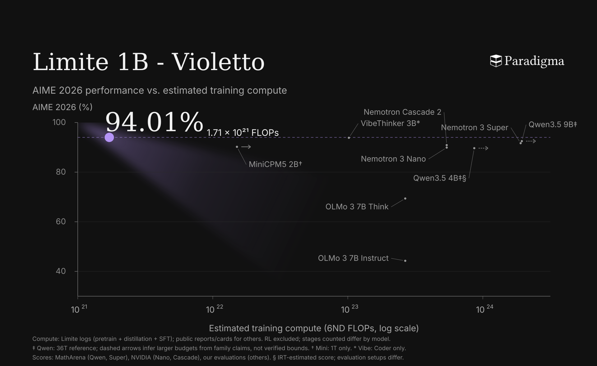
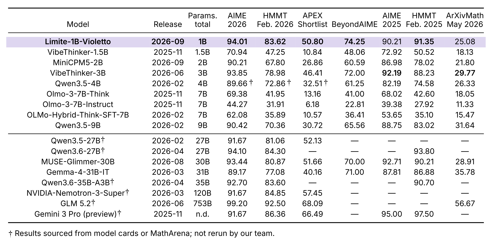

<p align="center">
  <picture>
    <source media="(prefers-color-scheme: dark)" srcset="assets/paradigma-logo-white.svg">
    <source media="(prefers-color-scheme: light)" srcset="assets/paradigma-logo-black.svg">
    
  </picture>
</p>

<h1 align="center">Limite 1B - Violetto</h1>

<p align="center">A model for high-frequency mathematical intelligence.</p>

<p align="center">
  <a href="https://huggingface.co/paradigma-inc/limite-1b-violetto">Model weights</a> ·
  <a href="https://paradigma.inc/blog/limite-1b-violetto/">Blog</a> ·
  <a href="#quickstart">Quickstart</a>
</p>

## Quickstart

**Full installation (recommended).** No extras or manual version selection are required.

**Python 3.12 · vLLM 0.28.0 · PyTorch 2.13.0 (CUDA 13.0) · Transformers 5.6.2**

This is the fully tested default, fixed by `uv.lock`. The plugin's decode
kernels are written against vLLM 0.28.0 and refuse any other vLLM build at
startup.

On Linux x86-64 with an NVIDIA GPU and a CUDA 13.0-compatible NVIDIA driver,
install [uv](https://docs.astral.sh/uv/getting-started/installation/), then run:

```bash
git clone https://github.com/paradigma-inc/limite-violetto.git
cd limite-violetto
uv sync --locked
```

The default installation includes the plugin, vLLM, CUDA-enabled PyTorch, Transformers,
and their locked dependencies. The repository selects the PyTorch CUDA 13.0
wheel index automatically; no separate PyTorch or CUDA toolkit installation is
needed. The NVIDIA driver must already be installed on the host.

Model weights are downloaded from Hugging Face on first use.

## Serving

From the same directory, start Violetto:

```bash
VLLM_PLUGINS=limite uv run --locked vllm serve paradigma-inc/limite-1b-violetto
```

**Sampling settings:** We recommend `temperature=0.6` and `top_p=0.95`. These defaults are included in [`generation_config.json`](https://huggingface.co/paradigma-inc/limite-1b-violetto/blob/main/generation_config.json) and are loaded automatically by the vLLM command above. Explicit request parameters override these defaults, so set both values explicitly if your client supplies its own sampling settings.

The server exposes vLLM's OpenAI-compatible API at
`http://localhost:8000/v1`. Send chat requests to
`POST /v1/chat/completions`; no Limite-specific client is required:

```bash
curl http://localhost:8000/v1/chat/completions \
  -H 'Content-Type: application/json' \
  -d '{
    "model": "paradigma-inc/limite-1b-violetto",
    "messages": [
      {"role": "user", "content": "Solve 2x + 3 = 11."}
    ]
  }'
```

This request deliberately omits sampling fields and therefore uses the
checkpoint defaults above. Clients that populate their own defaults should
send `temperature=0.6` and `top_p=0.95` explicitly.

For other Limite checkpoints, use:

```bash
VLLM_PLUGINS=limite uv run --locked vllm serve paradigma-inc/<model>
```

Replace `<model>` with `limite-1b-base`, `limite-1b-base-soup`, or `limite-1b-violetto`.

Model repositories must include weights and tokenizer assets. Their `config.json` must specify:

```json
{
  "model_type": "limite",
  "architectures": ["LimiteForCausalLM"]
}
```

The remaining architecture fields are also required and checked before the inference graph is constructed. The plugin registers `LimiteConfig` itself, so serving does not require another source checkout or the native Transformers implementation. The current implementation requires tensor and pipeline parallel sizes of one.

Send the mathematical problem as a user message and use the checkpoint's bundled chat template to apply the model's mathematical prompt.

### Serving performance

Version 0.2.0 runs the decode-critical steps as Triton kernels: the attention
prologue (value embeddings, QK RMS norm, partial rotary) and epilogue (XSA
correction, output gate), decode attention on the 36 sliding-window layers, and
the LM head with its fp32 softcap, plus three exact patches to vLLM's seeded
sampler. The kernels keep every bf16 rounding of the reference graph.

Output tokens per second on one H100 80GB, serving 900 MATH-500 prompts (natural
output lengths, temperature 0.6, top-p 0.95) with `--max-model-len 131072
--gpu-memory-utilization 0.9`. Requests carry a per-request seed, as evaluation
harnesses send, unless the row says otherwise. The two versions were measured
side by side on one node, with four server starts each:

| Requests in flight | 0.1.0 (vLLM 0.26.0) | 0.2.0 (vLLM 0.28.0) | Speedup |
|---:|---:|---:|---:|
| 1 | 322 | 389 | 1.21x |
| 8 | 1,982 | 2,490 | 1.26x |
| 32 | 5,925 | 7,526 | 1.27x |
| 64 | 10,007 | 12,395 | 1.24x |
| 128 | 15,338 | 18,098 | 1.18x |
| 320 | 20,538 | 24,928 | 1.21x |
| 320, requests without a `seed` | 21,693 | 24,667 | 1.14x |

Most of the gain comes from the kernels: version 0.1.0 on vLLM 0.28.0 measures
21,220 tokens/s at 320 in flight. Quality is unchanged. Against the reference
implementation, the per-step KL stays within twice the reference's own
bf16-vs-fp32 floor, and far below the parity gate, up to 16,000 prompt tokens.
On MATH-500 (500 problems x 4 seeds), 0.2.0 scores 91.7% and 0.1.0 scores
90.9%; the paired difference is +0.8 points with a standard error of 0.4.

### Install only the plugin

If you already manage a Python 3.12 environment with vLLM and a compatible
GPU stack, build the plugin wheel from this checkout and install it
without resolving dependencies. Activate that environment first so `python` and
`vllm` refer to its executables:

```bash
uv build --wheel
python -m pip install --no-deps --force-reinstall dist/limite_vllm-0.2.0-py3-none-any.whl
VLLM_PLUGINS=limite vllm serve paradigma-inc/limite-1b-violetto
```

`--no-deps` preserves the installed runtime dependencies; you are responsible
for their compatibility. The environment must provide vLLM 0.28.0: the plugin
checks the version and the source of the vLLM modules it extends before it
builds the model, and refuses anything else. Building a
wheel does not install the runtime. Avoid `uv sync` in this checkout when using
this path, since it manages the complete runtime described in the quickstart.

The CUDA wheel source and lockfile are repository-level uv settings, not wheel
metadata; installing the package as a dependency of another project does not
inherit them.

## Reproducing evaluations

The evaluator is a separate package under [`limite-evals/`](limite-evals/). It
uses its own locked environment, starts the Limite vLLM plugin itself, downloads
or reuses immutable Hugging Face snapshots, and writes each run under
`outputs/eval/<run-id>/` by default. Allocate a compatible NVIDIA GPU using your
machine or scheduler, then install the evaluator:

```bash
cd limite-evals
uv sync --locked
```

Run the complete pinned `math-extended` suite with its declared defaults:

```bash
uv run --locked limite-eval paradigma-inc/limite-1b-violetto \
  --run-id violetto-math-extended
```

`--run-id` is an optional user-chosen label for the output directory. Omit it
to generate a timestamped id automatically. Every run writes to a new directory
and never overwrites an existing one.

Replace the model id with `paradigma-inc/limite-1b-base` or
`paradigma-inc/limite-1b-base-soup` to evaluate the other Limite releases. The
checkpoint allowlist selects `posttrain`/`chat` for Violetto and
`pretrain`/`base-kshot` for Base and Base Soup. The default sampling seed is
`0`; model revisions, rendering hashes, dataset revisions, sampling settings,
engine details, scores, and diagnostics are recorded with the run. See the
[evaluator README](limite-evals/README.md) and `uv run limite-eval --help` for
the complete contract and option reference.

## About the model

Limite 1B - Violetto is Paradigma’s first model, designed for high-throughput solutions of difficult mathematical problems.

Pretrained from scratch with fewer than 300 billion curated tokens, then refined through supervised fine-tuning and reinforcement learning, Violetto focuses on solving one mathematical problem at a time. Its dense architecture has approximately one billion parameters and a configured context of 131,072 tokens.

This repository provides the vLLM serving implementation. The checkpoint and tokenizer are hosted on [Hugging Face](https://huggingface.co/paradigma-inc/limite-1b-violetto). Read the [release blog](https://paradigma.inc/blog/limite-1b-violetto/) for the training overview and examples.

## Evaluation

[](assets/aime26-flops.png)

*Training compute is estimated; RL is excluded and counted training stages vary by model. The figure identifies its sources and symbols; table sources are noted below.*

Selected models and mathematical benchmarks. Scores are percentages.



**Table notes.** † Results sourced from model cards or MathArena; not rerun by our team. Results reflect their respective evaluation configurations; external results may use different protocols.

## Built for mathematics

Violetto is built around mathematical reasoning, with deliberately light instruction tuning and a focus on solving one problem at a time. The [release blog](https://paradigma.inc/blog/limite-1b-violetto/) includes worked solutions and examples of how this specialization shapes its responses.

## Plugin development

```bash
uv sync --locked --group dev
uv run --no-sync pytest
uv run --no-sync ruff check .
uv build
```

The optional `dev` group adds test and lint tools to the same CUDA runtime;
there is no competing CPU-only PyTorch installation. Package tests use vLLM
stubs and do not replace an actual GPU serving check.

The attention backend and the seeded-sampler patches extend vLLM 0.28.0
internals and check their source digests at startup, so moving to another vLLM
release means re-porting and re-validating those modules.

The implementation lives in `src/limite_vllm`.

## Code license

The serving code in this repository is licensed under [Apache-2.0](https://github.com/paradigma-inc/limite-violetto/blob/main/LICENSE).

## Citation

Refer to the citation published in the [release blog](https://paradigma.inc/blog/limite-1b-violetto/).
